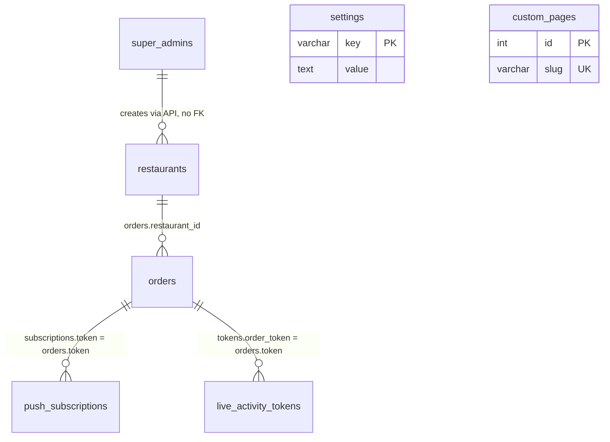

# Pager (Paiger) — project audit

Read-only survey of `/var/www/pager` on 2026-11-06. No code, schema, service, or package was changed.
Secrets are marked `[SET]` or `[MISSING]`. Values are not reproduced.

Product today: Arabic-first virtual pager. Super-admin creates a restaurant. Staff open a cashier screen, issue an order, show a QR. The customer opens `/pager/{token}` (App Clip on iPhone, web page otherwise). Marking the order `ringing` is the “ready” signal (there is no status named `ready`).

---

## 1. Stack and structure

### Languages, frameworks, versions

| Layer | What | Version / note |
|---|---|---|
| Language | Python | 3.9.25 (`/var/www/pager/venv`) |
| API | FastAPI | 0.128.8 (`requirements.txt` pins `>=0.110.0`) |
| Server | Uvicorn | 0.39.0, `[standard]` extra |
| Templates | Jinja2 | 3.1.6 |
| Validation | Pydantic v2 models inside FastAPI | via FastAPI |
| DB driver | PyMySQL 1.2.3 + DBUtils 3.2.0 pool | `app/database.py` |
| DB engine | MariaDB | 10.5.29, database name from `DB_NAME` |
| Auth | bcrypt 5.0.0 + PyJWT 2.15.1 (HS256) | `app/auth.py` |
| QR | qrcode 8.2 + Pillow 11.3.0 | |
| Web Push | pywebpush 2.1.2 | `app/push_service.py` |
| APNs | httpx 0.28.1 (HTTP/2) + PyJWT ES256 | no dedicated APNs SDK |
| Markdown | Markdown 3.9 | CMS pages only; **not listed in `requirements.txt`** |
| HTTP client | httpx 0.28.1 | **not listed in `requirements.txt`** |
| Env | python-dotenv 1.2.1 | |
| Forms | python-multipart 0.0.20 | |
| CSS / JS libs | none | no Tailwind, Bootstrap, React, Vue, Alpine |
| Fonts | Google Fonts: Readex Pro, sometimes Sora | CDN |
| Icons | Material Icons Outlined (CDN) + inline SVG + emoji | |
| Frontend build | none | each page is one HTML file with inline CSS and JS |
| Flutter | **NOT FOUND** on this server (`pubspec.yaml` search under `/var/www`, `/opt`, `/home`, `/root`) | |

Package file: `requirements.txt` (14 lines, minimum pins only, no lockfile).

### Folder tree

```
/var/www/pager
├── run.py                         alternate entry (systemd does not use it)
├── requirements.txt
├── .env                           gitignored; keys listed in §11
├── test_apns.py                   manual APNs poke, not a test suite
├── flutterapp.md, NextStep.md, GEMINI.md, MYFATOORAH_GUIDE.md
├── بيجر — Landing.html            unused design mock, not routed
├── بيجر - لوحة الكاشير.html        unused design mock, not routed
├── venv/                          CPython 3.9
└── app/
    ├── main.py                    all HTTP + WebSocket routes (1246 lines)
    ├── database.py                schema bootstrap + queries (955 lines)
    ├── auth.py                    JWT cookies
    ├── apns_service.py            Live Activity pushes
    ├── push_service.py            Web Push (VAPID)
    ├── myfatoorah_service.py      payment gateway client
    ├── seed_custom_pages.py       one-off CMS seed, not called at startup
    ├── AuthKey_WQKP75FDML.p8      APNs auth key, tracked in git
    ├── vapid_keys.json            Web Push keypair, tracked in git
    ├── templates/                 10 Jinja pages, CSS/JS inlined
    └── static/
        ├── apple-app-site-association
        ├── sw.js, manifest.json, favicon.*
        ├── css/style.css          unused (no template links it)
        ├── js/cashier.js          unused
        ├── js/pager.js            unused
        ├── img/                   brand-logo.png, brand-ready.png, icon-512.png, logos_b64.js (unused)
        └── audio/                 chime.wav, buzzer.wav, silent.wav
```

### How it runs

| Item | Value |
|---|---|
| Process manager | systemd unit `/etc/systemd/system/pager.service` (active). Not pm2, not supervisor, not Docker. |
| Process user | `root` |
| Command | `venv/bin/uvicorn app.main:app --host 127.0.0.1 --port 8035 --workers 2 --proxy-headers --forwarded-allow-ips "*"` |
| Bind | `After=` and `BindsTo=mariadb.service`, `Restart=always` |
| Web server | nginx `/etc/nginx/conf.d/pager.rahapp.com.conf` |
| Domain | `pager.rahapp.com` only. No pager subdomain besides that. |
| Ports | nginx `:80` (301 to HTTPS, plus ACME and AASA) and `:443` http2. App listens `127.0.0.1:8035`. |
| SSL | Let's Encrypt `/etc/letsencrypt/live/pager.rahapp.com/`. Renewal webroot `/var/www/pager/certbot`. |
| Workers | Uvicorn **2 processes**. nginx `worker_processes auto`, `worker_connections 1024`. Upstream keepalive 16. |
| WebSocket proxy | `location /ws/` timeouts 86400s, buffering off |
| Static | nginx serves `/static/`, `/sw.js`, `/manifest.json`, and AASA directly from `app/static` |
| Cron for this app | **NOT FOUND** (`crontab -l` has no pager job) |
| Queue / Redis / Celery | **NOT FOUND**. Notifications are in-process `asyncio.create_task`. |
| Logs | nginx `/var/log/nginx/pager_rahapp_access.log` and `pager_rahapp_error.log`. App uses uvicorn access log + `print()`. |
| `run.py` | Dev-style launcher. Default host/port from env (`127.0.0.1` / `8035`). `--dual` would bind `0.0.0.0:8000` and `:8443` with local `cert.pem`/`key.pem`. Production does not use it. |

**Worker hazard:** `ConnectionManager` (`app/main.py` 48–111) is in-memory per process. With `--workers 2`, the HTTP request that rings an order and the customer’s WebSocket can land on different workers, so the socket push is dropped. The customer page polls every 1s (`pager.html` 1402), which hides the bug.

### Database

- Engine: MariaDB 10.5.29, InnoDB, `utf8mb4`.
- Config: `app/database.py` 15–19 reads `DB_HOST`, `DB_PORT`, `DB_USER`, `DB_PASSWORD`, `DB_NAME` from `/var/www/pager/.env`. All five are `[SET]`. Defaults in code: host `127.0.0.1`, port `3306`, user `pager_user`, name `pager_db`.
- Pool: max 25 connections, min cached 2, max cached 10, `autocommit=False` (`database.py` 23–40).
- Migrations tool: **NOT FOUND** (no Alembic, no SQL migration folder). Schema is `CREATE TABLE IF NOT EXISTS` inside `init_db()` on every startup (`database.py` 59–174, called from `main.py` 191–193). No `ALTER` path, so later column changes will not apply to an existing table.
- Live schema matches `init_db()`. Foreign keys: **none** (`information_schema` returned an empty FK list).
- Live row counts (no PII): `restaurants` 1 (active), `super_admins` 1, `orders` 22 (20 `done`, 2 `waiting`), `push_subscriptions` 8, `live_activity_tokens` 20, `custom_pages` 4, `settings` 1 (`theme` = `light`).

---

## 2. Data model

Logical links only. The database does not enforce them.



### `super_admins` (`database.py` 65–73)

| Field | Type | Notes |
|---|---|---|
| id | INT AI PK | |
| username | VARCHAR(100) UNIQUE | |
| email | VARCHAR(150) UNIQUE | |
| password_hash | VARCHAR(255) | bcrypt |
| full_name | VARCHAR(150) default `Super Admin` | |
| created_at | DATETIME | |

Indexes: PK, unique username, unique email.

### `restaurants` (`database.py` 77–94) — the tenant

| Field | Type | Notes |
|---|---|---|
| id | INT AI PK | id `1` is protected from delete (`main.py` 404–405) |
| name | VARCHAR(150) | |
| slug | VARCHAR(100) UNIQUE | URL key `/r/{slug}` |
| email | VARCHAR(150) UNIQUE | login id |
| password_hash | VARCHAR(255) | one password for the whole restaurant |
| phone | VARCHAR(50) default `''` | |
| brand_color | VARCHAR(30) default `#C05621` | |
| brand_icon | VARCHAR(50) default `cup.and.saucer.fill` | SF Symbol name in schema; admin UI stores Material icon names |
| logo_url | VARCHAR(255) default `''` | column exists, **never read or written** |
| avg_prep_time | INT default 5 | minutes |
| is_active | TINYINT(1) default 1 | login blocked when 0 |
| created_at / updated_at | DATETIME | |

Indexes: PK, unique slug, unique email, plus non-unique `idx_slug` and `idx_email` (duplicates).

### `orders` (`database.py` 98–117)

| Field | Type | Notes |
|---|---|---|
| id | INT AI PK | |
| restaurant_id | INT NOT NULL default 1 | indexed, no FK |
| order_number | VARCHAR(50) | cashier-entered, not unique |
| customer_name | VARCHAR(100) default `''` | |
| notes | TEXT | |
| token | VARCHAR(64) UNIQUE | `uuid4().hex[:10]` (`database.py` 489) |
| status | VARCHAR(20) default `waiting` | `waiting` / `ringing` / `onway` / `done` |
| call_count | INT default 0 | incremented on each ring |
| restaurant_name, brand_color, brand_icon | copied onto the order | snapshot, not a live join |
| created_at, called_at, completed_at | DATETIME | `called_at` set on ring, `completed_at` on done |

Indexes: PK, unique `token`, non-unique `idx_token` (duplicate), `idx_status`, `idx_restaurant`. No index on `(restaurant_id, order_number)`.

### `push_subscriptions` (`database.py` 121–130)

Web Push subscription per order token: `token`, `endpoint` UNIQUE, `p256dh`, `auth`, `created_at`. Index `idx_sub_token`.

### `live_activity_tokens` (`database.py` 142–151)

`order_token`, `push_token` UNIQUE(512), `device_type` default `ios_live_activity`, timestamps. Index `idx_order_token`. Not deleted when the order completes.

### `settings` (`database.py` 134–138)

Key/value. Only live key: `theme` = `light`. `set_setting()` exists (`database.py` 745) but no route calls it. `get_setting("restaurant_name")` is a fallback only (`database.py` 498).

### `custom_pages` (`database.py` 155–171)

CMS for privacy / terms / about / contact. Fields: `slug` UNIQUE, `title`, `title_en`, `content` MEDIUMTEXT, `content_en`, `meta_description`, `is_published`, `show_in_footer`, `sort_order`, timestamps. Indexes: unique slug, duplicate `idx_page_slug`, `idx_page_published`.

Live slugs: `privacy-policy`, `terms-of-service`, `about-us`, `contact-support`. Arabic and English bodies are both stored.

### Multi-tenant?

**Partial.** There is no column named `tenant_id`. A restaurant row is the tenant, and `orders.restaurant_id` separates orders. Public URLs use `slug`. Dashboards that render HTML do scope by the JWT `sub`.

What is **not** scoped:

- `GET/POST /api/orders` and every status mutation take an id or an optional `restaurant_id` query with **no auth** (`main.py` 887–986).
- `/ws/cashier` is one global room (`main.py` 89–95, 1076–1083). Restaurant A hears restaurant B’s “on the way” toasts, then reloads its own list.
- `/r/{slug}/cashier` and `/r/{slug}/print` are public (`main.py` 653–688).
- Default `restaurant_id = 1` if the client omits it (`main.py` 121, 897).

### Concept checklist

| Concept | Status |
|---|---|
| Users / roles | **PARTIAL** — two roles only: `super_admin`, `restaurant`. No permission table. |
| Restaurants | **EXISTS** — `restaurants` |
| Staff (many users per restaurant) | **NOT FOUND** — one email + one password per restaurant |
| Orders | **EXISTS** |
| Devices / push tokens | **EXISTS** — `push_subscriptions` (Web Push) and `live_activity_tokens` (APNs). No generic device table. |
| Plans | **NOT FOUND** |
| Subscriptions | **NOT FOUND** |
| Trials | **NOT FOUND** |
| Payments (persisted) | **PARTIAL** — MyFatoorah client exists; no `payments` table; webhook does not write anything |
| Points / credits | **NOT FOUND** |
| Invoices | **NOT FOUND** (MyFatoorah returns `InvoiceId` in the HTTP response only) |

---

## 3. Backend routes and APIs

Auth cookies: `sa_pager_session` (super-admin), `rest_pager_session` (restaurant). Both also accept `Authorization: Bearer`. “Public” means no check at all.

FastAPI’s default `/docs`, `/redoc`, and `/openapi.json` are **enabled** (`FastAPI(...)` at `main.py` 21 has no `docs_url=None`).

### Public web

| Method | Path | Handler | Auth | Purpose | Request → response |
|---|---|---|---|---|---|
| GET | `/` | `index_route` `main.py:723` | public | Landing | HTML `landing.html`. Context: footer pages, optional current admin/restaurant. |
| GET | `/login`, `/restaurant/login` | `restaurant_login_page` `:518` | public | Restaurant login form | HTML. Redirects to `/dashboard` if cookie valid. |
| POST | `/login`, `/restaurant/login` | `restaurant_login_submit` `:527` | public | Login | Form `identifier`, `password` → 302 + cookie, or 400/403 HTML error. |
| GET | `/logout`, `/restaurant/logout` | `restaurant_logout` `:569` | public | Clear restaurant cookie | 302 `/login`. |
| GET | `/p/{slug}`, `/page/{slug}` | `public_custom_page` `:765` | public | CMS page | HTML. 404 if missing or unpublished. |
| GET | `/r/{slug}` | `restaurant_customer_track` `:632` | public | Enter order number | Query `num`. If a matching order exists, 302 to `/pager/{token}`. Else HTML track form. |
| GET | `/r/{slug}/cashier` | `restaurant_dedicated_cashier` `:653` | **public** | Cashier UI | HTML `cashier.html`. |
| GET | `/r/{slug}/print` | `restaurant_qr_print_sheet` `:676` | **public** | Printable stand | HTML `qr_print.html`. |
| GET | `/cashier` | `default_cashier_redirect` `:690` | optional | Cashier | If restaurant cookie, 302 to `/r/{slug}/cashier`. Else cashier for restaurant id 1. |
| GET | `/pager/{token}`, `/order/{token}` | `pager_page` `:791` | public (token is the secret) | Customer pager | HTML `pager.html`, or inline 404 HTML. |
| GET | `/checkout/{order_id}` | `page_embedded_checkout` `:1173` | **public** | Payment demo | Query `amount` default `5.0`. HTML. |
| GET, POST | `/payment/myfatoorah/return` | `page_myfatoorah_return` `:1189` | public | 3DS return page | Query `paymentId`. Inline HTML, Arabic. |
| GET, HEAD | `/.well-known/apple-app-site-association`, `/apple-app-site-association` | `apple_app_site_association` `:199` | public | AASA | In production nginx serves the static file first. App fallback JSON uses placeholder `TEAMID.com.rahapp.pager` (`main.py` 209–220) and is not what Apple sees. |
| GET, HEAD | `/sw.js` | `get_service_worker` `:225` | public | Service worker | `app/static/sw.js` |
| GET, HEAD | `/manifest.json` | `get_manifest` `:233` | public | PWA manifest | Arabic name strings |
| GET | `/static/*` | StaticFiles mount `:24` | public | Assets | Also served by nginx. |

### Restaurant dashboard

| Method | Path | Handler | Auth | Purpose | Request → response |
|---|---|---|---|---|---|
| GET | `/dashboard`, `/merchant` | `restaurant_dashboard` `:576` | restaurant cookie | Owner dashboard | HTML. Loads stats + last 150 orders. 302 `/login` if anonymous, `/logout` if row missing. |
| POST | `/api/merchant/settings` | `api_merchant_save_settings` `:601` | restaurant | Update own profile | JSON `MerchantSettingsDto` (`main.py` 161–167): `name`, `phone`, `brand_color`, `brand_icon`, `avg_prep_time`, `new_password`. Response `{status, restaurant}` including `password_hash` (`SELECT *`). Cannot change slug, email, or `is_active`. |

The dashboard’s order buttons call the **public** order APIs below. They are not under `/api/merchant`.

### Super-admin

| Method | Path | Handler | Auth | Purpose | Shape |
|---|---|---|---|---|---|
| GET | `/admin/login` | `super_admin_login_page` `:241` | public | Login form | HTML |
| POST | `/admin/login` | `super_admin_login_submit` `:249` | public | Login | Form `identifier`, `password` → 302 `/admin` + cookie (7 days) or 400 HTML |
| GET | `/admin/logout` | `super_admin_logout` `:282` | public | Clear cookie | 302 `/admin/login` |
| GET | `/admin`, `/admin/dashboard` | `super_admin_dashboard` `:288` | super-admin | One-page admin | HTML. Stats, up to 200 restaurants, 300 orders, all CMS pages. |
| GET | `/api/admin/stats` | `api_admin_stats` `:342` | super-admin | KPI JSON | `get_platform_stats()` (`database.py` 234–242) |
| POST | `/api/admin/restaurants` | `api_admin_create_restaurant` `:314` | super-admin | Create tenant | `CreateRestaurantDto` `:140–148`. 400 if slug or email taken. Returns full row. |
| PUT | `/api/admin/restaurants/{id}` | `api_admin_update_restaurant` `:349` | super-admin | Update tenant | Partial `UpdateRestaurantDto`. |
| POST | `/api/admin/restaurants/{id}/toggle-status` | `:375` | super-admin | Flip `is_active` | `{status, is_active, restaurant}` |
| DELETE | `/api/admin/restaurants/{id}` | `:399` | super-admin | Delete tenant + its orders | Refuses id 1. Does not delete push or Live Activity rows. |
| GET | `/api/admin/pages` | `:414` | super-admin | List CMS | `{status, pages}` |
| POST | `/api/admin/pages` | `:421` | super-admin | Create page | `CreateCustomPageDto` `:169` |
| PUT | `/api/admin/pages/{id}` | `:445` | super-admin | Update page | |
| DELETE | `/api/admin/pages/{id}` | `:475` | super-admin | Delete page | Refuses slugs `privacy-policy` and `terms-of-service` |
| POST | `/api/admin/pages/{id}/toggle-published` | `:490` | super-admin | | |
| POST | `/api/admin/pages/{id}/toggle-footer` | `:502` | super-admin | | |

### Mobile / App Clip / order API (all public)

| Method | Path | Handler | Purpose | Shape |
|---|---|---|---|---|
| GET | `/api/pager/{token}/status`, `/api/orders/{token}/details` | `get_order_details` `:823` | Order + queue | Flat JSON (`main.py` 832–851): ids, status, brand, queue, theme. 404 `{detail}`. |
| POST | `/api/orders/{token}/onway` | `mobile_onway_order` `:853` | Customer says “I’m coming” | Body empty. Returns order. Broadcasts WS. |
| POST | `/api/orders/{token}/live-activity-token`, `/api/orders/{token}/live-activity` | `register_live_activity_token` `:869` | Register APNs activity token | JSON `push_token` or `pushToken`, optional `device_type`. `{status, message}`. |
| GET | `/api/orders` | `list_orders` `:887` | List orders | Optional `?restaurant_id=`. Array, max 150. **No auth.** |
| POST | `/api/orders` | `create_new_order` `:891` | Create order | `CreateOrderRequest` `:117–124`. Returns order row. Notifies cashiers. |
| POST | `/api/orders/{id}/ring`, `/call` | `ring_order` `:905` | Ready / ring | Sets `ringing`, WS + Web Push + APNs. Returns order. |
| POST | `/api/orders/{id}/onway` | `onway_order` `:932` | Same as customer on-way, by numeric id | |
| POST | `/api/orders/{id}/done`, `/complete` | `complete_order` `:949` | Picked up | Sets `done`. WS only. No APNs “end”. |
| POST | `/api/orders/{id}/waiting`, `/reset` | `reset_order` `:964` | Back to waiting | Does not clear `call_count`. |
| DELETE | `/api/orders/{id}` | `delete_order` `:979` | Delete | `{status: success}` even if missing. |
| GET, HEAD | `/api/qr/{token}` | `get_qr_image` `:992` | PNG QR | Optional `?host=`. Encodes `https://{DOMAIN}/pager/{token}`. Token `demo` or `stand` encodes `host` as-is (`main.py` 1003–1004). |
| GET | `/api/push/public_key` | `:1026` | VAPID public key | `{public_key}` |
| POST | `/api/push/subscribe` | `:1030` | Save Web Push sub | `{token, endpoint, p256dh, auth}` → `{status: ok}` |
| GET | `/api/pages` | `:740` | Published CMS list | Compact JSON, no HTML body |
| GET | `/api/pages/{slug}` | `:758` | One CMS page | Full row including markdown |

### Webhooks and payments (all public)

| Method | Path | Handler | Purpose |
|---|---|---|---|
| GET | `/api/payment/myfatoorah/config` | `:1108` | `{gateway, currency, country, mode, is_test, api_base, session_script_url}`. Does not return the API key. |
| POST | `/api/payment/myfatoorah/session` | `:1113` | Query `amount` (default 1.0), `customer_identifier`. `{ok, session}` or 400. |
| POST | `/api/payment/myfatoorah/process` | `:1122` | `ProcessPaymentDto` `:1090–1098`. `{ok, invoice_id, redirect_url, data}` or `{ok:false, error}`. Nothing stored. |
| POST | `/api/payment/myfatoorah/charge-token` | `:1151` | Charge a saved card token. Same: no DB write. |
| POST | `/api/payment/myfatoorah/webhook` | `:1232` | HMAC check, then `logger.info`. **`logger` is not defined in `main.py`**, so a valid webhook raises `NameError` after the signature check. No payment row is written. |

### Realtime

| Path | Handler | Auth | Behavior |
|---|---|---|---|
| WS `/ws/pager/{token}`, `/ws/order/{token}` | `websocket_pager` `:1039` | token in URL | On connect: `{event: connected, order, queue_info, theme}`. Client `{action: onway\|acknowledge}` sets status `onway`. `{action: ping}` → `{event: pong}`. |
| WS `/ws/cashier` | `websocket_cashier` `:1076` | **none** | Accepts and ignores inbound text. Server pushes `order_created`, `order_updated`, `customer_onway`, `order_deleted` to every cashier on **that worker**. |

Events sent to a pager socket: `order_ringing`, `order_onway`, `order_done`, `order_waiting`, `order_deleted` (`main.py` 912–984).

---

## 4. Notifications and realtime

“Ready” = status `ringing`, triggered by `POST /api/orders/{id}/ring` (`main.py` 905–930). Four channels fire together:

| Channel | How | File |
|---|---|---|
| WebSocket | `manager.notify_pager` with `event: order_ringing` | `app/main.py` 76–87, 912–916 |
| Web Push | VAPID via pywebpush. Arabic title/body, icon, url `/pager/{token}`. 404/410 deletes the subscription. | `app/push_service.py` 46–98, `app/static/sw.js` 12–38 |
| APNs Live Activity | Token auth (`.p8` + JWT ES256), **not** a certificate. Library: httpx HTTP/2, not an APNs SDK. | `app/apns_service.py` |
| In-page audio + vibration | Customer page synthesizes a beep and vibrates; also loops `chime.wav` | `app/templates/pager.html` 963, 1088–1225 |
| Polling fallback | `GET /api/pager/{token}/status` every **1000 ms** | `pager.html` 1377–1402 |

APNs details (`apns_service.py`):

- Key file `app/AuthKey_WQKP75FDML.p8`. Key id `WQKP75FDML`, team `KRVGAD732T`, bundle `com.dawrak.app` (lines 8–11).
- JWT cached 3000 seconds (line 19).
- Payload `event: update`, content-state `orderNumber`, `statusText`, `isRinging`, `phase` (lines 54–65). Alert title/body only when ringing (lines 66–71). Sound is `"default"`, not `pager_ring.wav` (the `NextStep.md` sample is not what the code sends).
- Topics tried: `com.dawrak.app.push-type.liveactivity` and `com.dawrak.app.Clip.push-type.liveactivity` (lines 74–77).
- Hosts tried: sandbox then production. First HTTP 200 wins (lines 80–101).
- `done` / `onway` do **not** send an APNs `end` or update. The widget stays on the last ring payload.
- Registration is not tied to a verified device. Anyone with the order token can overwrite a push token (`main.py` 869–881).

Web Push is best-effort on Android Chrome and desktop. iOS Safari Web Push needs an installed Home Screen web app; the App Clip path does not use it.

### App Clip flow

1. Cashier creates an order. QR PNG encodes `https://pager.rahapp.com/pager/{10-char-token}` (`main.py` 994–1009, domain from `DOMAIN`).
2. Stand QR (`qr_print.html` 127) uses token `stand` plus `host=https://pager.rahapp.com/r/{slug}`, so the printed code opens the **number-entry** page, not a specific order.
3. AASA file (what nginx actually serves): `app/static/apple-app-site-association`. Also reachable at `/.well-known/apple-app-site-association` and `/apple-app-site-association` (`nginx` conf lines 60–74). Content-Type `application/json`. Paths inside the file: `/pager/*`, `/order/*`, `/r/*`, and `/*`. App IDs: `KRVGAD732T.com.dawrak.app`, `KRVGAD732T.com.dawrak.app.Clip`, plus a second team `TPYCH8628Q` for the same bundles. `webcredentials` lists both full apps.
4. Smart banner: `pager.html` line 16 has `app-clip-bundle-id=com.dawrak.app.Clip` and **no** `app-id`. Landing and customer-track include `app-id=6829547522` (`landing.html` 6, `customer_track.html` 6).
5. Web page also links `dawrak://pager/{token}` (`pager.html` 841) for the installed app.
6. The Clip (not in this repo) is expected to `POST /api/orders/{token}/live-activity-token` with `push_token`. Server stores it in `live_activity_tokens`.
7. On ring, server pushes an ActivityKit `update`. There is no code that ends the activity or deletes the token. The privacy page claims tokens are deleted when the order completes; the code does not do that (`seed_custom_pages.py` 46–48 vs `complete_order`).

Admin UI shows **different** Apple ids than the file Apple fetches: team `7V3J58823K`, bundles `com.rahapp.pager` / `com.rahapp.pager.clip`, pattern `/order/*` only (`super_admin_dashboard.html` 1587–1608). Those strings are hardcoded display text.

### Android and other phones

No Android project on this server. Those phones get the same `pager.html`:

- WebSocket + 1s polling.
- Permission sheet, then Web Audio beep, `chime.wav`, vibration, in-page banner.
- Web Push if the browser allows `pushManager.subscribe` (`pager.html` 1054–1080).
- “I’m on my way” button → `POST /api/orders/{id}/onway` and a WS `{action:onway}`.
- No Live Activity, no native widget.

`pager.js` still builds a Media Session lock-screen player (`pager.js` 52–97). `pager.html` does **not** load that file. `flutterapp.md` asks for that Media Session code to be removed; the live page already inlines its own audio instead.

---

## 5. Auth and roles

| Item | Finding |
|---|---|
| Login methods | Password form only. No OAuth, no magic link, no OTP. |
| Restaurant identity | Email **or** slug (`main.py` 534–536). |
| Super-admin identity | Username **or** email (`database.py` 184–186). |
| Session | JWT HS256 in an HttpOnly, `Secure`, `SameSite=lax` cookie. Restaurant 30 days (`main.py` 563). Super-admin 7 days (`main.py` 276). Token `exp` inside the JWT is 72 hours (`auth.py` 29–31), so the cookie outlives the token. |
| Bearer | Same JWT accepted from `Authorization` (`auth.py` 46–49, 60–62). |
| Password hashing | bcrypt (`auth.py` 18–27). |
| Roles | `super_admin` and `restaurant` only. No owner-vs-staff split. No permission checks beyond `payload.role`. |
| Enforcement | Copy-pasted `if not user: 401/302` on admin and merchant routes. Order, cashier, payment, and WebSocket routes skip it. |
| Sign-up | **NOT FOUND.** A restaurant exists only after a super-admin creates it. |
| Password reset | **NOT FOUND.** |
| Email sending | **NOT FOUND** (no SMTP library, no templates). |
| CSRF tokens | **NOT FOUND.** `SameSite=lax` covers cookie POST from other sites. |
| Account seed | `.env` has `SUPER_ADMIN_*` and `DEMO_RESTAURANT_*` (`[SET]`). **No Python reads those keys.** Rows already exist in the DB (1 admin, 1 restaurant). |
| Inactive restaurant | Login returns 403 HTML (`main.py` 544–548). Cashier URL still works. |
| JWT secret | `JWT_SECRET` is `[SET]`. It equals the fallback literal in `auth.py` line 13, so the secret is also in source. |

`GET /api/admin/restaurants` responses and merchant settings return `password_hash` because `get_restaurant_by_id` is `SELECT *` (`database.py` 354).

---

## 6. Page inventory

Every human-facing screen. Shared facts unless noted: `lang="ar"` `dir="rtl"`, no loading skeleton, no i18n catalog. “Arabic strings” is a count of Arabic word-runs, not sentences.

Design system is not shared. Each file has its own `<style>`. Dashboards use a cream page (`#f6f3ed`), ink `#23150d`, accent `#C05621`, Readex Pro, Material Icons. Landing is a separate marketing layout. Pager and checkout are dark.

### `/` — Landing — `app/templates/landing.html` (384 lines)

- Who: public. Purpose: product story and links into cashier / login. Not a pricing or sign-up page.
- UI: nav (logo, Features, How it works, Get started, language button, login, “try cashier”), hero with animated cashier+phone mock (`#08`, fake names), 6 feature cards, 3 steps, closing band, footer (CMS links + hardcoded Arabic copyright).
- Data: footer page titles from `custom_pages`. Copy is a JS dictionary `D.ar` / `D.en` (`landing.html` 302–343). Default `lang='ar'` (line 345). Toggle flips `dir` (line 355).
- Hardcoded Arabic: yes, ~310 runs, but most sit in the dictionary and do switch. Leftovers that do **not** switch: admin/dashboard links (205–207), footer copyright (294), footer CMS titles (always `fp.title`, Arabic), “Flutter guide” link (291) which points at `/flutterapp.md` (that path is not served → 404).
- RTL: yes, toggled.
- Problems: no pricing, no sign-up, CTA goes to `/login` and the public demo cashier `/r/main/cashier`. Demo loop is fake data. Domain and “main” slug are assumed.

### `/login` and `/restaurant/login` — `restaurant_login.html` (235)

- Who: restaurant staff. Purpose: sign in.
- UI: logo badge, title, subtitle, error box, form fields **identifier** (email or slug) and **password**, submit, link to super-admin login, CMS footer.
- Data: `error`, `identifier`, `footer_pages`.
- Arabic: yes, ~31 runs. RTL fixed. No EN toggle.
- Problems: no “forgot password”, no sign-up, no show-password, placeholder contains a real-looking domain.

### `/admin/login` — `super_admin_login.html` (233)

- Same layout as restaurant login, darker primary. Fields: identifier (username or email), password. Link back to restaurant login. Arabic ~34. RTL fixed. No reset.

### `/dashboard` and `/merchant` — `restaurant_dashboard.html` (827)

- Who: logged-in restaurant. Purpose: stats, orders, settings, links to cashier and print stand.
- UI:
  - Header: restaurant name, slug, buttons “cashier”, “settings”, logout.
  - Hero: hardcoded cashier URL, copy button, open cashier, print stand.
  - Stats: today, active (waiting | ringing), done today, all-time, avg prep minutes.
  - Orders table columns: number, customer, notes, status, time, pager link, actions (ring, complete, delete).
  - Tabs: all / waiting / ringing / onway / done. Search box (client-side).
  - Empty row: “no orders yet”.
  - Modal “new pager”: order number, customer name, notes. Submit reloads the page.
  - Modal settings: name, phone, color picker + hex, prep minutes, new password. No logo upload despite `logo_url`.
- Data: server render from `get_restaurant_stats` + `get_restaurant_orders`. Mutations hit public `/api/orders`. Settings hit `/api/merchant/settings`.
- Realtime: `/ws/cashier` reloads the **whole page** on any restaurant’s create/update/onway (`restaurant_dashboard.html` 812–823). No filter by `restaurant_id`.
- Arabic: yes, ~201. RTL fixed. **No `@media` query** — table will overflow on a phone; iPad landscape is the assumed width.
- Problems: full reload, unscoped websocket, cashier URL hardcoded to `https://pager.rahapp.com`, no staff list, no billing, status badges are Arabic only, errors are `alert()`.

### `/cashier` and `/r/{slug}/cashier` — `cashier.html` (1553)

- Who: anyone with the URL. This is the iPad screen.
- UI:
  - Top bar: brand mark in restaurant color, name, link to `/dashboard` (dead-end if not logged in), live slug pill.
  - Column 1: numpad (digits, clear, display default `42`), submit “issue pager”. Optional name/note live in dialog `#dlg` (labels at 1017–1020) — the primary path is the numpad.
  - Column 2: active orders (waiting, ringing, onway) with badge count.
  - Column 3: done orders.
  - Card actions by status (`cashier.html` 1168–1171): waiting → Ring; ringing → Repeat + Received; onway → Received; done → Reset. Also delete and show QR.
  - Dialogs: create sheet, QR modal (image, HTTPS toggle, open, copy, close), confirm delete, toast.
- Data: `GET /api/orders?restaurant_id=` then client render. Create `POST /api/orders`. Actions `POST .../ring|done|waiting` and `DELETE`. WS `/ws/cashier` reloads the list and toasts onway **without checking restaurant** (1532–1539).
- Arabic: yes, ~230. RTL fixed. Breakpoints 1200 / 980 / 880 / 540 (lines 284, 289, 888, 892) so the 3 columns stack.
- Problems: no login on the screen itself, numpad starts at 42, global WS toasts leak across tenants, QR host logic is easy to get wrong, very large single file, touch targets exist but the page is visually separate from the dashboard.

### `/r/{slug}/print` — `qr_print.html` (141)

- Who: anyone. Purpose: counter tent card.
- UI: print button, close, badge, restaurant name, subtitle, QR image, Arabic instruction, English line “Scan with phone camera…”, footer “Paiger”.
- Data: restaurant name/color. QR is the **stand** URL `/r/{slug}`, not an order (`qr_print.html` 127).
- Arabic: ~28, plus one English sentence. RTL. Print CSS hides buttons.
- Problem: customer must type the order number after scanning. That is a different flow from the per-order QR on the cashier modal.

### `/r/{slug}` — `customer_track.html` (177)

- Who: customer. Purpose: type order number, redirect to pager.
- UI: icon, restaurant name, description, error alert, field `num`, submit. No results list.
- Data: restaurant row. Lookup `get_order_by_number_and_restaurant` (latest row if duplicates).
- Arabic: ~22. RTL. No EN. App Clip meta includes app id.
- Problem: duplicate order numbers return the newest only. No empty-state beyond the error string.

### `/pager/{token}` and `/order/{token}` — `pager.html` (1498)

- Who: customer. Purpose: wait, ring, acknowledge.
- UI:
  - Permission modal: title, two feature rows, “allow alerts”, “open in app” (`dawrak://`).
  - Floating banner: title, body, “I’m on my way”.
  - Tap-to-play banner if autoplay is blocked.
  - Widget: logo, clock, customer chip, notes chip, big order number, status title + subtitle, 3 step dots, “people ahead”, “estimated wait”, “page updates live”, connection hint.
  - Audio element `chime.wav`.
  - Missing order: inline dark 404 (`main.py` 796–804), bilingual heading, link to `/login` (wrong destination for a customer).
- States in JS map (`pager.html` 1248–1252): waiting, ringing, onway, done.
- Data: order + `get_order_queue_info` (Arabic time string from `database.py` 644–668). Then WS and 1s poll.
- Arabic: ~146 in the template, plus Arabic from the API (`estimated_wait`). RTL fixed. No EN.
- Realtime: yes. Loading: clock starts `--:--`. Error: fetch failure is swallowed and polling continues.
- Problems: 1500-line page, dark theme unlike the cream dashboards, queue copy is Arabic-only on the server, permission modal is aggressive, `app-id` missing on the smart banner, estimated wait falls back to a hardcoded Arabic phrase.

### `/admin` — `super_admin_dashboard.html` (2702)

- Who: super-admin. Purpose: all tenants, all orders, CMS, a static “Apple” panel.
- Sections (sidebar, not separate URLs):
  1. **Overview** — KPIs: restaurants, today orders, active now, done today. Recent orders table. Live pill.
  2. **Restaurants** — search; filters all/active/inactive; columns: identity+slug, email, phone, prep time, order counts, status, actions (open cashier, copy link, edit, toggle, delete). Empty state is just an empty tbody.
  3. **Orders** — search, restaurant `<select>`, status pills; columns: number, restaurant, customer, status, wait, created, actions (ring / done).
  4. **Terminals** — card per restaurant: cashier URL, totals, open, print QR, copy.
  5. **Settings** — read-only Apple ids (**wrong**, see §4) and server blurb. Links to `/docs` and `/cashier`. Not editable.
  6. **Pages** — columns: title AR/EN, slug, sort, published switch, footer switch, updated, actions. Add/edit modal with Arabic and English title + markdown body.
- Modals: add restaurant (name, slug, email, password, phone, prep minutes, color swatches, icon `<select>` of Material names), edit restaurant (same family of fields), add/edit page, toasts.
- Data: server-rendered, then JS calls `/api/admin/*`. WS `/ws/cashier` refreshes orders and toasts (`super_admin_dashboard.html` 2667–2698).
- Arabic: ~902 runs. RTL. One breakpoint at 960px (sidebar becomes overlay).
- Problems: one 2700-line file, no plans/billing, Apple panel is fiction, `/docs` is linked in production, iPad sidebar is tight, no confirmation standard beyond per-button JS.

### `/p/{slug}` and `/page/{slug}` — `custom_page.html` (347)

- Who: public. Purpose: legal/about/support.
- UI: language button (label “English”), badge, `h1`, updated date, article. Second article is English, hidden, `direction: ltr` (`custom_page.html` 264–294).
- Data: markdown rendered to HTML in `main.py` 773–774. English falls back to Arabic body if `content_en` is empty.
- Arabic: chrome ~24 runs; body is DB content (large). Toggle is per page, not a site locale. Date is the raw ISO string.

### `/checkout/{order_id}` — `payment_checkout.html` (251)

- Who: anyone. Purpose: MyFatoorah embedded demo, not tied to a pager order row.
- UI: dark card, title, order id, amount with 3 decimals + currency, `#mf-form` (session.js), loading line, “save card” checkbox, pay button, trust line.
- Data: `initiate_session(amount)` on the server before render. Failure would 500 the page (exception is not caught in `page_embedded_checkout`).
- Arabic: ~60. RTL. Amount format `"%.3f"` is correct for BHD (`payment_checkout.html` 132).
- Not linked from landing, dashboard, or cashier.

### `/payment/myfatoorah/return` — inline HTML in `main.py` 1206–1230

- Who: customer after 3DS. Success or fail icon, Arabic title, payment id, link home. No template file. No receipt, no restaurant, no invoice record.

### Emails

**NOT FOUND.** No HTML email, no text template.

### Error pages

**NOT FOUND** as templates. Unknown routes: FastAPI JSON 404. Missing pager: inline HTML. Missing restaurant/page: `HTTPException` JSON even for browser routes (`main.py` 636, 770).

### Pages that must be created (NEW)

| Page | Why |
|---|---|
| Pricing (can extend landing) | No plans, no prices |
| Sign up | Restaurants are created only by super-admin |
| Email verification | No mail |
| Trial status | No trial fields |
| Billing / subscription | No subscription |
| Points wallet + top-up | No ledger |
| Invoices list + detail | No invoice table; return page is not an invoice |
| Payment method management | Charge-token API exists, no UI to list saved cards, no card table |
| Admin plan management | **NEW** |
| Admin tenant billing (trial, plan, suspend for non-payment) | Tenant CRUD exists; billing does not. Extend, don’t pretend it exists |
| Admin payments ledger | **NEW** |
| Password reset request + confirm | **NEW** |
| Staff users (if more than one login per restaurant) | **NEW** |
| Branded 404 / 500 | **NEW** |
| EN/AR shell shared by every screen | Only landing and CMS have a toggle |

---

## 7. Design system today

- Approach: **custom CSS per template**. Not Tailwind, not Bootstrap, no component partials (no ``).
- Shared file `app/static/css/style.css` (914 lines, dark tokens at lines 6–25: `#07090e`, `#38bdf8`, `#f59e0b`, `#ff334b`, `#10b981`) is **not linked**. Dead.
- `app/static/js/cashier.js` (301) and `pager.js` (364) are **not linked**. Dead copies of older UIs. `img/logos_b64.js` unused.
- Colors actually on screen:
  - Dashboards / logins: cream `#f6f3ed`, card white, ink `#23150d`, muted `#7a6656`, brand `#C05621`, radius 24px.
  - Landing: its own variables, accent still `#C05621` (`landing.html` 221).
  - Pager + checkout + payment return: dark slate (`#0f172a` / `#08090d`).
- Fonts: Readex Pro (Arabic-capable) from Google Fonts. Sora for a few Latin bits. No self-hosted font.
- Icons: Material Icons Outlined, emoji, a few inline SVGs. Restaurant `brand_icon` is inconsistent (SF Symbol default vs Material names in the admin form).
- Images: `app/static/img/brand-logo.png`, `brand-ready.png`, `icon-512.png`, `favicon.png`, `favicon.ico`.
- Audio: `chime.wav` (used), `buzzer.wav` and `silent.wav` (only referenced by dead `pager.js`).
- Dark mode: `data-theme` is passed (`theme` setting, currently `light`) on cashier and pager. No theme switcher UI. `set_setting` is never called from a route. Not a real dark mode.
- Breakpoints that exist: landing (stacked footer), cashier 1200/980/880/540, super-admin 960, dead `style.css` 960. Restaurant dashboard: **none**.
- Duplication: login pages share the same CSS copied twice. Status colors and buttons are reimplemented in cashier, restaurant dashboard, and super-admin.

---

## 8. Internationalization

Mechanism: **none** (no Babel, gettext, i18next, or JSON catalog).

Where strings live:

| Area | Rough Arabic word-runs | EN already? |
|---|---|---|
| `super_admin_dashboard.html` | ~902 | a few labels (“English”, “Swagger”) |
| `landing.html` | ~310 | full dictionary, default Arabic |
| `cashier.html` | ~230 | a few Latin labels (“ORDER NUMBER”) |
| `restaurant_dashboard.html` | ~201 | slug shown as Latin |
| `pager.html` | ~146 | 404 heading is bilingual |
| `main.py` error strings + payment return | ~146 | one 404 heading |
| `payment_checkout.html` | ~60 | currency code from env |
| `database.py` `format_arabic_time` | ~27 | no; queue API is Arabic |
| `apns_service.py` / `push_service.py` | ~15 / ~8 | alert text Arabic only |
| `sw.js` | ~19 | |
| `custom_page.html` chrome | ~24 | body has `content_en` + a button |
| Dead `pager.js` / `cashier.js` | ~105 / ~67 | ignore or delete |

Dates: sliced ISO strings (`created_at[:16]`), not locale-formatted. Numbers: raw integers. Currency: only on the checkout demo, `%.3f` + `MYFATOORAH_CURRENCY`. Queue estimates are Arabic phrases (`database.py` 644–668), including “جاهز للاستلام الآن”.

### Cleanest path for EN default + AR RTL (no rewrite)

Stay on Jinja.

1. Add `app/i18n/en.json` and `app/i18n/ar.json`.
2. Cookie `lang`, default `en`. A tiny helper `t(key)` registered on `templates.env`.
3. Base layout sets `<html lang dir>` from that cookie. One CSS file uses logical properties (`margin-inline`, `inset-inline`) so RTL does not need a second stylesheet.
4. Landing already has the pattern (`D.en` / `D.ar` + `dir` toggle). Move that dictionary into the JSON files and make EN the default.
5. CMS already has `title_en` / `content_en`. Public page should follow the cookie instead of a one-off button. Footer links should use the active language.
6. Replace `format_arabic_time` with a function that returns a number of minutes plus a translated unit, so the API can send `estimated_wait_minutes` and the UI translates it.
7. APNs/Web Push copy: pick language from a field on the order or default to `en`, with `ar` as the alternate. ActivityKit content-state can carry both strings if the widget is still Arabic-only until the Flutter phase.
8. Do not introduce a SPA. The pages are server-rendered; a catalog + one layout is enough.

---

## 9. Payments readiness

Gateway code: **MyFatoorah only** (`app/myfatoorah_service.py`, routes in `main.py` 1085–1246, demo `payment_checkout.html`, guide `MYFATOORAH_GUIDE.md`).

| Key | State |
|---|---|
| `MYFATOORAH_PAYMENT_MODE` | `[SET]` (selects live vs test URL) |
| `MYFATOORAH_API_URL` | `[SET]` |
| `MYFATOORAH_API_KEY` | `[SET]` |
| `MYFATOORAH_TEST_API_URL` | `[SET]` |
| `MYFATOORAH_TEST_API_KEY` | `[SET]` |
| `MYFATOORAH_WEBHOOK_SECRET` | `[SET]` |
| `MYFATOORAH_COUNTRY_ISO` | `[SET]` |
| `MYFATOORAH_CURRENCY` | `[SET]` |
| Tap / BenefitPay / Stripe keys | `[MISSING]` — no code, no packages |

What the client can do today:

- Embedded session `POST /v3/sessions` (`myfatoorah_service.py` 52–73).
- Execute `POST /v3/payments` with `InvoiceValue` rounded to **3 decimals** (line 104). Currency from env.
- Saved-card charge (`direct_charge_saved_card`, line 125).
- Status `GET /v3/payments/{id}` (line 164).
- Webhook HMAC-SHA256 (line 176). Empty secret would **skip** verification (`return True`, lines 180–181). Secret is currently `[SET]`, so that bypass is inactive.
- Phone country is hardcoded `+973` and a fallback mobile `33000000` (lines 101–103, 143). Not read from the restaurant.

What it does **not** do: store payments, attach them to a restaurant, send a receipt, subscribe, top up points, or survive the webhook (`logger` missing in `main.py` 1245). Amounts are Python `float`, not `Decimal`. Checkout default amount is `5.0` (`main.py` 1174).

Bahrain fit, without installing anything:

- **MyFatoorah** is already the right regional aggregator (cards, Benefit, Apple Pay, Google Pay, depending on the merchant account). Wiring it to plans is an application change, not a new SDK.
- **Tap Payments** and **BenefitPay** are plain HTTPS APIs. `httpx` (already installed) can call them. No SDK is required for a server charge + webhook.
- **Stripe** has no package installed. Billing in BHD with 3 decimal places is a poor fit (Stripe’s BHD support should be confirmed before choosing it). Not recommended as the first gateway when MyFatoorah is already live-keyed.

3-decimal rule for any new money column: `DECIMAL(10,3)`, never float, never `int` truncation. `_serialize_row` currently casts whole Decimals to `int` (`database.py` 56), which would turn `1.000` into `1` and is safe only if you never store fils as Decimal and then serialize. Prefer returning strings for money.

---

## 10. Mobile side

Flutter project: **NOT FOUND** in this repo or the searched server paths.

What this server knows, from docs and APIs only:

| Item | Source |
|---|---|
| Team | `KRVGAD732T` (`NextStep.md` 11, `apns_service.py` 10). A second team `TPYCH8628Q` is in the AASA file only. |
| App Store id | `6829547522` (`NextStep.md` 12) |
| Bundle | `com.dawrak.app` |
| App Clip | `com.dawrak.app.Clip` |
| Widget | `com.dawrak.app.DawrakWidget` (`NextStep.md` 15) — server never addresses this bundle except via the Live Activity topic |
| Flutter version | **NOT FOUND** |
| Localization in the app | **NOT FOUND** here. Server alerts are Arabic. |
| Endpoints the app must call | `GET /api/orders/{token}/details`, `POST /api/orders/{token}/live-activity-token`, `POST /api/orders/{token}/onway`, `WS /ws/pager/{token}` or `/ws/order/{token}` |
| Widget screens | **NOT FOUND** in this repo. `flutterapp.md` says the widget code exists on the other machine and is waiting on backend Media Session removal. |

Admin screen text (`com.rahapp.pager`, team `7V3J58823K`) does not match the shipping identifiers. Treat `NextStep.md` + `apns_service.py` + the AASA file as the source of truth, and the admin panel as stale.

---

## 11. Quality, security, risks

### Secrets in the tree

| Item | Risk |
|---|---|
| `.env` | Gitignored (`.gitignore` 20). Keys `[SET]`: DB_*, PORT, HOST, DOMAIN, JWT_SECRET, SUPER_ADMIN_*, DEMO_RESTAURANT_*, MYFATOORAH_*. |
| `app/auth.py:13` | Hardcoded JWT fallback. Current `JWT_SECRET` equals that literal. |
| `app/AuthKey_WQKP75FDML.p8` | **Tracked in git.** APNs private key. |
| `app/vapid_keys.json` | **Tracked in git.** Contains the Web Push private key. |
| `.gitignore` | Ignores `.env`, `*.pem`, `*.key`. Does **not** ignore `*.p8` or `vapid_keys.json`. |

### Access control

- Creating, listing, ringing, completing, and deleting any order requires no login (`main.py` 887–986).
- Cashier and print URLs are public.
- Payment session, process, and saved-card charge are public.
- `/docs` is public and linked from the admin UI.
- Webhook bug: `logger` is undefined (`main.py` 1245). A verified webhook returns 500.
- Restaurant API responses include `password_hash`.
- Service runs as **root**.
- Two uvicorn workers split the in-memory WebSocket bus.
- `forwarded_allow_ips="*"` trusts any `X-Forwarded-*` if a client can reach port 8035. nginx is the intended front door; the port is bound to localhost, which limits this.
- No rate limit, no CSRF token, no password strength rule, no slug charset rule (admin pages only replace spaces).
- `delete_restaurant` leaves push rows and Live Activity tokens behind.
- Privacy copy promises ephemeral tokens. Nothing deletes them (20 tokens still stored).

### Data and performance

- No FK, so `restaurant_id` can point at nothing. `create_order` still inserts (`database.py` 492–510).
- Duplicate indexes on `token`, `slug`, `email`.
- `get_restaurant_stats` runs 8 queries (`database.py` 377–432). Fine at current size (22 orders).
- `get_all_restaurants` is one grouped join, not N+1 (`database.py` 246–276).
- Admin HTML embeds up to 300 orders. No pagination API.
- `logo_url` is dead. `settings.restaurant_name` is never written.
- `SUPER_ADMIN_*` and `DEMO_RESTAURANT_*` env vars are unused by code.
- Errors: many `except: pass` / `print`. No structured logging, no error page.
- Backups of `pager_db`: **NOT FOUND**.
- Tests: **NOT FOUND**. `test_apns.py` is a manual script that posts to Apple. No pytest, no `tests/` directory. Nothing to run.
- TODO/FIXME in project source: **NOT FOUND** (only a phone placeholder `05XXXXXXXX`).
- Dead code: `static/css/style.css`, `static/js/cashier.js`, `static/js/pager.js`, `static/img/logos_b64.js`, root HTML mocks, `run.py` dual-server path, FastAPI AASA fallback with `TEAMID.com.rahapp.pager`.
- `httpx` and `markdown` are imported but missing from `requirements.txt`. A clean install from that file will fail those imports.
- Brand icon values disagree (SF Symbol vs Material), so the customer pager does not render the admin’s icon choice. Pager UI uses a PNG, not `brand_icon`.

---

## 12. Gap analysis and phased plan

### Goal 1 — Redesign every web page

- Exists: 10 templates, all custom, Arabic, visually inconsistent (cream admin vs dark pager). Landing is the only page that already looks like a campaign.
- Missing: shared layout, components, responsive restaurant dashboard, real empty/error/loading states, branded errors.
- Data model: no change required.
- Risk: cashier is the production iPad UI. A visual rewrite that changes DOM ids will break the inline JS. Keep behavior (numpad, ring, QR, onway) stable while restyling.
- Size: **L**. Files: every file in `app/templates/`, new `app/static/css/app.css`, delete or ignore dead `style.css` / `pager.js` / `cashier.js` after the new pages no longer need them. `main.py` only if context variables change.

### Goal 2 — EN default + AR with RTL

- Exists: landing dictionary (default AR), CMS `*_en` columns, one English line on the print stand, bilingual 404 heading.
- Missing: site-wide locale, translated API strings (`format_arabic_time`), push/APNs copy, `dir` on dashboards.
- Data model: optional `restaurants.locale` later. Not required for the UI cookie.
- Risk: queue text and notifications are generated in Python, not in the templates. Translating HTML only leaves the pager widget in Arabic.
- Size: **M** if done with the redesign (same templates). Files: new `app/i18n/en.json`, `app/i18n/ar.json`, `app/i18n.py`, `database.py` (`format_arabic_time`), `push_service.py`, `apns_service.py`, `main.py` error strings, all templates.

### Goal 3 — Public funnel: landing → sign up → 3-day trial → subscribe

- Exists: landing, login, super-admin create-restaurant, `is_active` flag.
- Missing: public registration, email, trial start/end, paywall, self-serve cancel.
- Data model (new): `users` or extra columns on `restaurants` (`trial_ends_at`, `email_verified_at`), `email_tokens`. Trial can be a timestamp, not a separate product, until plans exist.
- Risk: opening sign-up while order APIs are anonymous lets anyone ring or delete orders. **Lock down `/api/orders` mutations and `/r/{slug}/cashier` before the funnel is public.**
- Size: **L**. Files: `database.py`, `auth.py`, `main.py`, new templates (signup, verify, trial banner), mailer module (nothing exists).

### Goal 4 — Plans: monthly, yearly, pay-per-order points

- Exists: nothing. `settings` could hold a point price, but nothing reads a price today.
- Missing: plan CRUD, assignment, renewal dates, point balance, prepaid block/warn, post-paid usage.
- Data model (new):
  - `plans` (`code`, `kind` = `monthly` | `yearly` | `points`, `price_bhd DECIMAL(10,3)`, `interval`, `point_price_bhd`, `billing_mode` = `prepaid` | `postpaid`, `is_active`).
  - `subscriptions` (`restaurant_id`, `plan_id`, `status`, `trial_ends_at`, `current_period_end`).
  - `point_ledger` (`restaurant_id`, `delta`, `balance_after`, `reason`, `order_id`, `payment_id`) for prepaid.
  - `usage_cycles` for post-paid (orders in a month × point price).
  - Hook: `create_order` checks the plan. Points mode decrements the ledger or records usage. Monthly/yearly ignores points.
- Risk: `create_order` is unauthenticated, so a points balance would be drained by anyone who can POST. Enforce tenant auth first. BHD must be `DECIMAL(10,3)`. Do not use the current Decimal-to-int serializer for money.
- Size: **L**. Files: `database.py`, `main.py` (create order + admin plan routes), new admin section, restaurant billing pages.

### Goal 5 — Online payment

- Exists: MyFatoorah session, execute, token charge, status, webhook **skeleton**, checkout demo, 3-decimal rounding, live keys `[SET]`.
- Missing: persistence, auth, link to a restaurant, invoices, webhook that does not crash, idempotency, receipts, top-up and subscription charges.
- Data model: `payments` (`gateway`, `gateway_payment_id`, `amount DECIMAL(10,3)`, `currency`, `status`, `restaurant_id`, `purpose`) and `invoices`.
- Risk: public `charge-token` and `process` can move money if someone obtains a session. Put them behind login. Fix `logger` before relying on the webhook. Keep amounts at 3 decimals end to end.
- Size: **M** on top of goal 4, because the HTTP client is already there. Files: `myfatoorah_service.py`, `main.py` payment routes, `payment_checkout.html` (or a new billing checkout), `database.py`.

### Goal 6 — Flutter / App Clip later

- Exists on the server: AASA, smart banner, Live Activity register + update, Arabic push copy, docs.
- Missing here: the Flutter project, EN strings in the widget, APNs `end` event, token cleanup, agreement between admin UI ids and real bundle ids.
- Data model: none, if the app keeps using the order token.
- Risk: changing `/pager/{token}` or the Live Activity content-state keys (`orderNumber`, `statusText`, `isRinging`, `phase`) breaks the shipped widget. Don’t rename them in the redesign.
- Size: **L**, and it is not in this repository. Server follow-ups are **S**: `apns_service.py`, `pager.html` meta tag, admin settings panel copy.

### Suggested order

| Phase | Work | Size | Touches |
|---|---|---|---|
| 0 | Close public order/cashier/payment mutations; stop returning `password_hash`; fix webhook `logger`; stop committing the `.p8` and VAPID file | **M** | `main.py`, `auth.py`, `database.py` SELECT lists, `.gitignore` |
| 1 | Redesign + EN default / AR RTL | **L** | `app/templates/*`, new `app/static/css/app.css`, `app/i18n/*`, `database.py` time strings, push/APNs copy |
| 2 | Landing pricing block, sign-up, 3-day trial, email | **L** | `main.py`, `database.py`, new templates, new mail helper |
| 3 | Plans, subscriptions, points ledger, admin + restaurant billing screens | **L** | `database.py`, `main.py`, new templates, `create_order` |
| 4 | MyFatoorah charges for subscribe + top-up, invoices, webhook persistence | **M** | `myfatoorah_service.py`, `main.py`, `database.py`, checkout template |
| 5 | Flutter / App Clip EN + widget visuals | **L** | not on this server; server-side only `apns_service.py` and the pager meta tag |

Phase 0 is smaller than a redesign and removes the risk of shipping a public sign-up on top of open order APIs. The redesign itself does not require it, but the funnel does.
